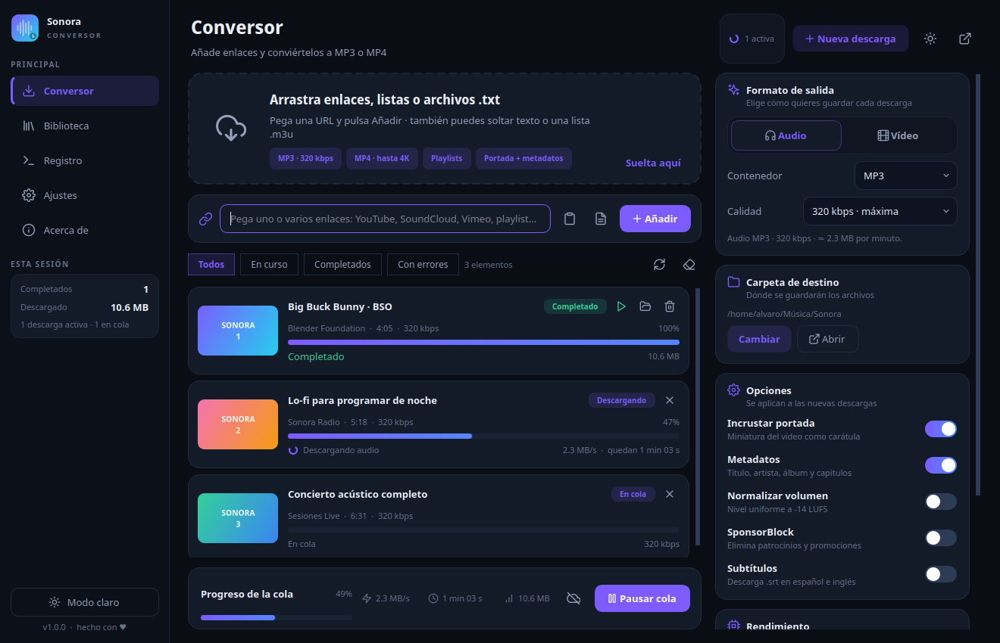
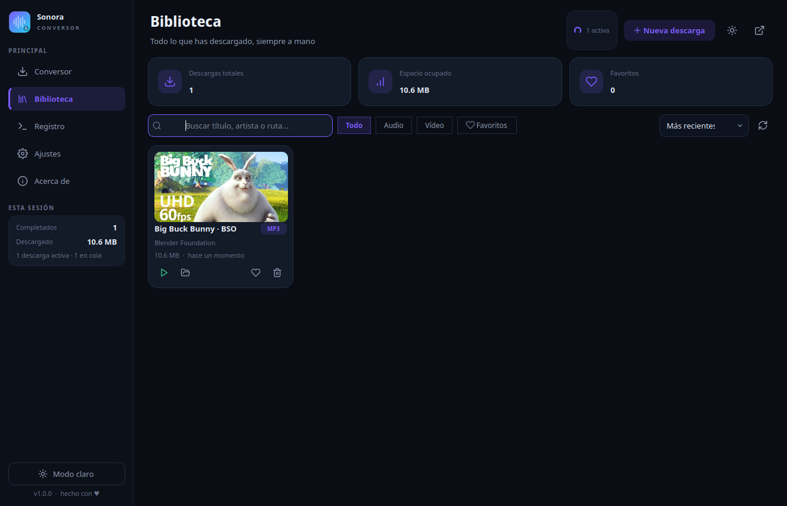
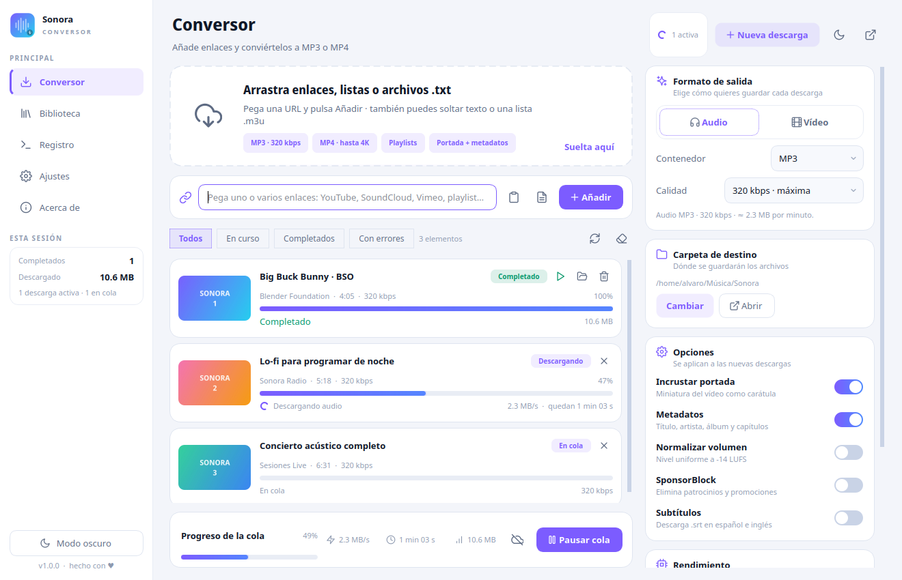
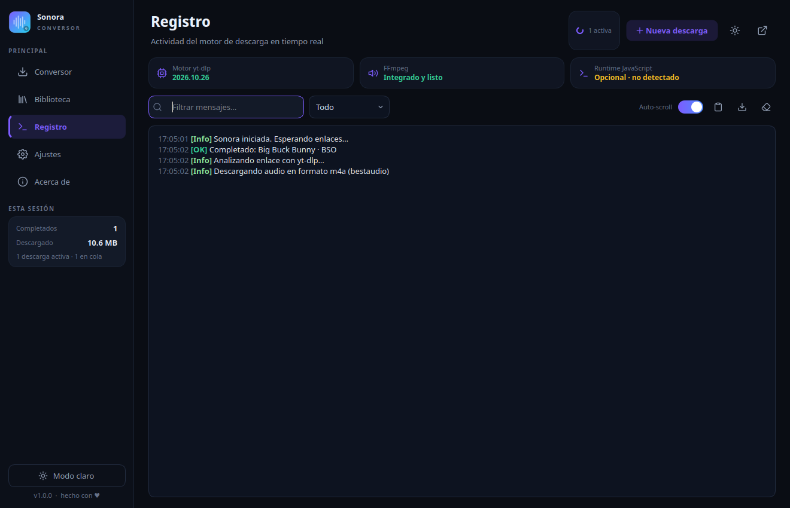
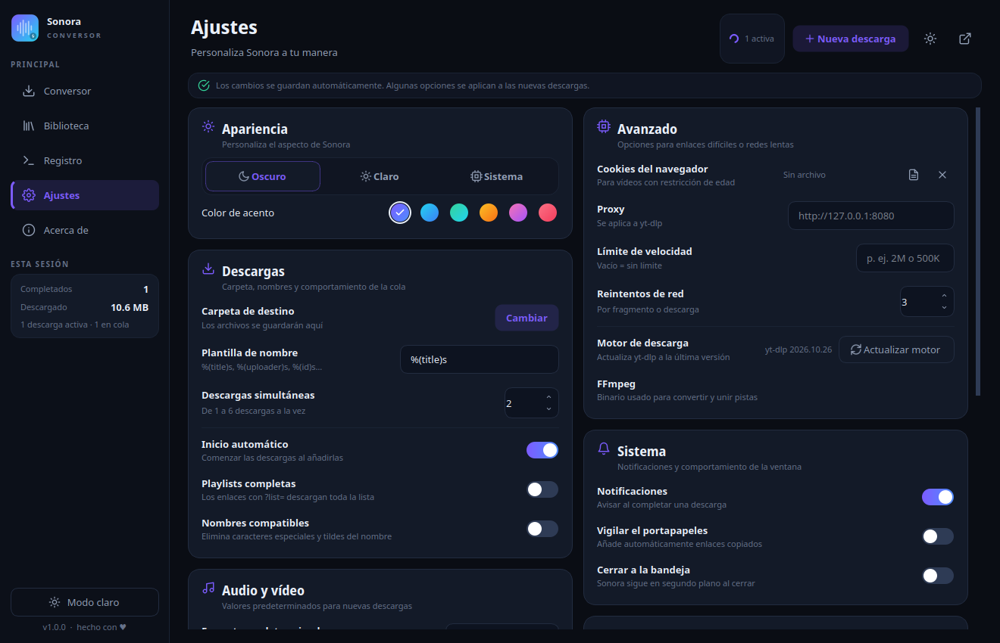
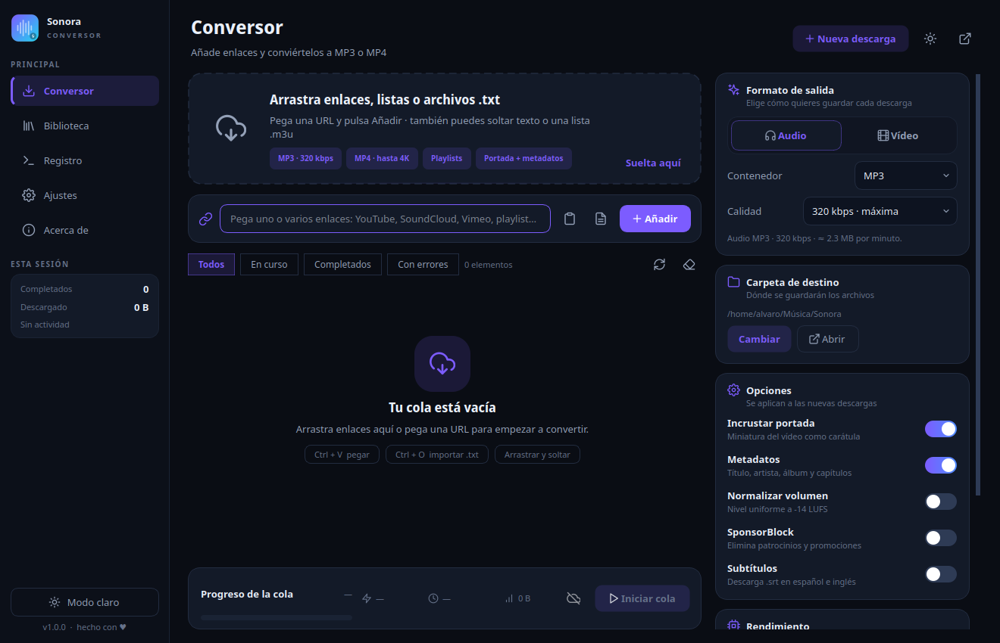
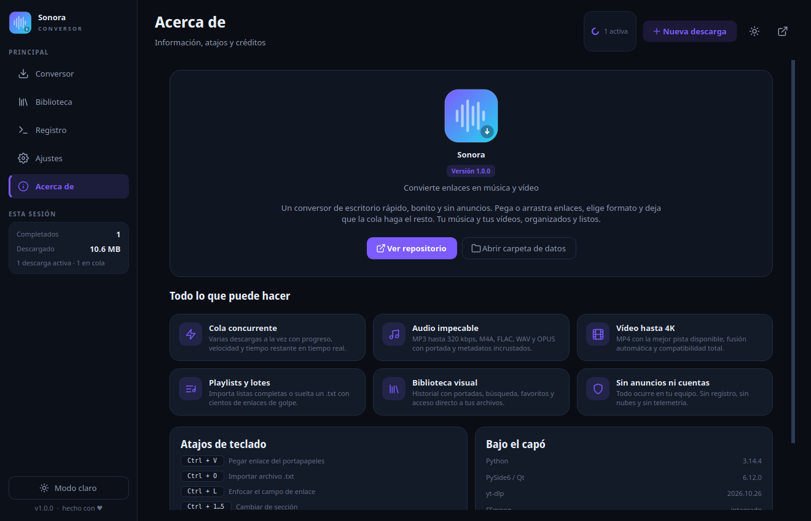

# Sonora

**Convierte enlaces en música y vídeo, con una cola bonita y sin complicaciones.**

Sonora es un conversor de escritorio para Linux, macOS y Windows construido con
Python y PySide6 (Qt 6). Pega o arrastra enlaces de YouTube, SoundCloud, Vimeo y
cualquier sitio compatible con yt-dlp, elige el formato y deja que la cola haga
el resto. MP3, M4A, FLAC, WAV, OPUS y MP4 hasta 4K, con portada, metadatos y
capítulos incrustados.



---

## Características

### Entrada flexible

- **Arrastrar y soltar** enlaces, texto suelto o archivos `.txt`, `.m3u`,
  `.m3u8`, `.url`, `.csv` y `.list`.
- **Pegar con `Ctrl + V`** o usar el botón del portapapeles.
- **Importar listas** de enlaces desde un archivo con `Ctrl + O`.
- **Playlists de YouTube** con un selector para elegir qué elementos descargar.
- Varios enlaces a la vez (hasta 300 por lote) y detección de duplicados.

### Conversión completa

- **Audio**: MP3 (320, 256, 192 o 128 kbps), M4A, FLAC, WAV y OPUS.
- **Vídeo**: MP4 con la mejor pista disponible o resolución forzada
  (2160p, 1440p, 1080p, 720p, 480p, 360p), H.264 + AAC para máxima
  compatibilidad.
- **Portada y metadatos** incrustados (título, artista, álbum, capítulos…).
- **SponsorBlock** para saltar patrocinios y promociones.
- **Subtítulos** `.srt` en español e inglés (idiomas configurables).
- **Normalización de volumen** a −14 LUFS con `loudnorm`.
- **Recorte** inicial y final del audio o vídeo.
- **FFmpeg incluido** mediante `imageio-ffmpeg`: no hace falta instalarlo aparte.

### Cola de descargas

- De 1 a 6 descargas simultáneas.
- Progreso, velocidad, tamaño y tiempo restante en tiempo real.
- Pausar, reanudar, cancelar, reintentar y vaciar elementos terminados.
- Filtros por estado: todos, en curso, completados y con errores.
- Estadísticas de la sesión en la barra lateral y notificaciones al terminar.

### Biblioteca visual

- Historial persistente en SQLite con tarjetas y miniaturas.
- Búsqueda por título, artista o ruta; filtros de audio, vídeo y favoritos.
- Ordenación por fecha, título o tamaño.
- Abrir el archivo o su carpeta, marcar favoritos y eliminar registros.

### Interfaz y extras

- Temas **oscuro**, **claro** y **sistema**, con seis acentos de color.
- Ajustes con guardado automático.
- Bandeja del sistema, cierre en segundo plano y notificaciones nativas.
- Registro del motor en tiempo real con filtros y autodesplazamiento.
- Ventana redimensionable, geometría y última página recordadas.
- Atajos de teclado para todo.

---

## Capturas

| Biblioteca | Tema claro |
| --- | --- |
|  |  |

| Registro | Ajustes |
| --- | --- |
|  |  |

| Cola vacía | Acerca de |
| --- | --- |
|  |  |

---

## Instalación

### Requisitos

- Python **3.10 o superior** (probado con 3.14).
- Un entorno gráfico con Qt 6 (X11 o Wayland).
- Conexión a Internet para descargar.
- `ffmpeg` **no** es necesario: se incluye con `imageio-ffmpeg`.

### Inicio rápido

```bash
git clone https://github.com/afc00073-lab/conversor_musica.git
cd conversor_musica
chmod +x run.sh
./run.sh
```

`run.sh` crea el entorno virtual `.venv` e instala las dependencias la primera
vez. Después solo abre la aplicación.

### Instalación manual

```bash
python3 -m venv .venv
source .venv/bin/activate        # Windows: .venv\Scripts\activate
pip install -r requirements.txt
python main.py
```

### Acceso desde el menú de aplicaciones (Linux)

```bash
./scripts/install_desktop.sh
```

Crea un lanzador `Sonora` en el menú de aplicaciones y usa el icono del
proyecto.

### Nota sobre YouTube

yt-dlp recomienda tener un runtime de JavaScript para algunos formatos de
YouTube. Sonora funciona sin él, pero si encuentras vídeos que no se extraen,
instala [Deno](https://deno.com/) y vuelve a intentarlo. También puedes
actualizar el motor desde **Ajustes → Motor de descarga**.

---

## Uso rápido

1. **Añade enlaces**: arrástralos a la zona superior, pégalos con `Ctrl + V` o
   impórtalos desde un `.txt`.
2. **Elige el formato** en el panel derecho: audio o vídeo, contenedor y
   calidad. Las opciones de portada, metadatos, SponsorBlock, subtítulos y
   normalización se aplican a las nuevas descargas.
3. **Pulsa Añadir**. Si el inicio automático está activo, la cola empieza sola;
   si no, usa **Iniciar cola**.
4. Cuando termine, abre el archivo o su carpeta desde la tarjeta, o encuéntralo
   en **Biblioteca**.

---

## Atajos de teclado

| Atajo | Acción |
| --- | --- |
| `Ctrl + V` | Pegar enlaces del portapapeles y añadirlos |
| `Ctrl + O` | Importar un archivo `.txt` / `.m3u` |
| `Ctrl + L` | Enfocar el campo de enlace |
| `Ctrl + 1 … 5` | Cambiar de sección |
| `Ctrl + ,` | Abrir ajustes |
| `Ctrl + Shift + T` | Cambiar entre tema claro y oscuro |
| `Espacio` | Pausar o reanudar la cola |
| `F5` | Reintentar las descargas fallidas |

---

## Dónde se guarda todo

| Contenido | Ruta |
| --- | --- |
| Ajustes | `~/.config/sonora/settings.json` |
| Biblioteca (SQLite) | `~/.local/share/sonora/history.db` |
| Miniaturas y caché | `~/.cache/sonora/` |
| Descargas por defecto | `~/Música/Sonora/` |

Las rutas respetan `XDG_CONFIG_HOME`, `XDG_DATA_HOME` y `XDG_CACHE_HOME`.
Puedes cambiar la carpeta de destino desde el conversor o desde **Ajustes**.

---

## Estructura del proyecto

```
conversor_musica/
├── main.py                 # Punto de entrada
├── run.sh                  # Lanzador con entorno virtual automático
├── requirements.txt
├── assets/                 # Icono y recursos gráficos
├── core/
│   ├── config.py           # Ajustes persistentes y acentos
│   ├── downloader.py       # Motor yt-dlp + FFmpeg
│   ├── history.py          # Biblioteca SQLite
│   ├── manager.py          # Cola, concurrencia y señales
│   ├── models.py           # Dataclasses y enums
│   └── utils.py            # Utilidades y rutas XDG
├── ui/
│   ├── main_window.py      # Ventana, navegación, bandeja y atajos
│   ├── theme.py            # Paletas y hoja de estilos QSS
│   ├── widgets.py          # Componentes reutilizables
│   ├── thumbs.py           # Carga asíncrona de miniaturas
│   ├── dialogs.py          # Diálogos de playlist y confirmación
│   ├── icons.py            # Iconos SVG en color
│   └── pages/              # Conversor, biblioteca, registro, ajustes, acerca de
├── scripts/
│   └── install_desktop.sh  # Lanzador para el menú de Linux
├── tests/                  # Pruebas del núcleo con unittest
├── docs/screenshots/       # Capturas para la documentación
└── .github/workflows/      # Integración continua
```

---

## Notas técnicas

- **PySide6 / Qt 6** para la interfaz, con QSS personalizado y componentes
  dibujados a mano (barras de progreso animadas, interruptores, toasts…).
- **yt-dlp** como motor de extracción y descarga; **FFmpeg** incluido vía
  `imageio-ffmpeg` para conversión, fusión y postprocesado.
- **SQLite** para la biblioteca, con búsqueda, filtros y favoritos.
- La cola usa `QThreadPool` con cancelación cooperativa y señales Qt para no
  bloquear la interfaz.
- Probado en Linux con Python 3.14, PySide6 6.12, yt-dlp 2026.10.26 y
  FFmpeg 9.0.2.

### Desarrollo y pruebas

Las pruebas del núcleo no necesitan Qt, red ni archivos multimedia:

```bash
.venv/bin/python -m unittest discover -s tests -t . -v
```

GitHub Actions las ejecuta en Python 3.10, 3.12 y 3.14. También puedes
comprobar que la interfaz arranca sin pantalla:

```bash
QT_QPA_PLATFORM=offscreen .venv/bin/python main.py
```

---

## Aviso legal

Sonora es una herramienta personal para descargar contenido al que tengas
derecho de acceso. Respeta los términos de servicio de cada plataforma y las
leyes de propiedad intelectual de tu país. No se incluye ni se fomenta el uso
para redistribuir contenido protegido.

---

Hecho con cariño y Qt. Si encuentras un fallo o quieres proponer una mejora,
abre un issue en el [repositorio](https://github.com/afc00073-lab/conversor_musica).
